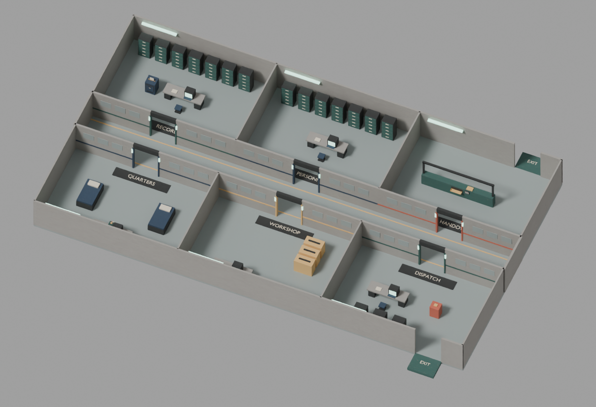

# 编号007：最后一次交接

你是夜班档案员 007。值班从碎纸机前开始。调查报废单、签收原件和旧录音，与 008 完成最后一次交接。七个调查节点串起同一条主线，阅读后会自动来到下一处现场。

## 操作

按 E 或点击画面下方按钮进行调查，点击「继续主线」推进。WASD 移动，左右方向键转身。触屏使用方向和转身按钮。J 打开手记，M 回到当前工位。每次到达工位时相机会自动面向线索。刷新页面会开始新的一班。

## 运行

在仓库根目录执行 `npm ci` 和 `npm run build`。构建好的 dist 可以直接部署到静态服务器。星匣预览使用 `star-letter dev`，随后在本机执行 `npm test` 运行 Chrome 端到端检查。测试默认使用 7421 端口，也可设置 GAME_URL。`star-letter check` 检查打包内容，`star-letter publish --draft` 保存草稿。游戏编号为 1015612。

剧情和控制在 game-entry.js，界面在 index.html。art 目录附 Blender 4.5 源文件、建模脚本和 ImageGen 工业材质图集。运行 art/build_facility.py 可重新导出地图，将生成的 GLB 和俯视图复制到 dist 即可更新游戏。图集已嵌入场景和 GLB。渲染使用 Three.js。
